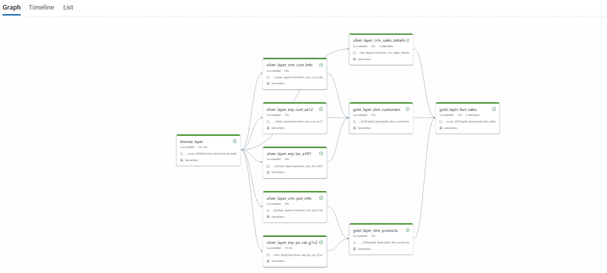
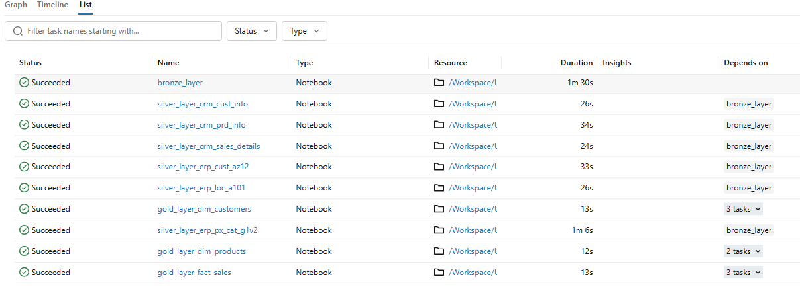
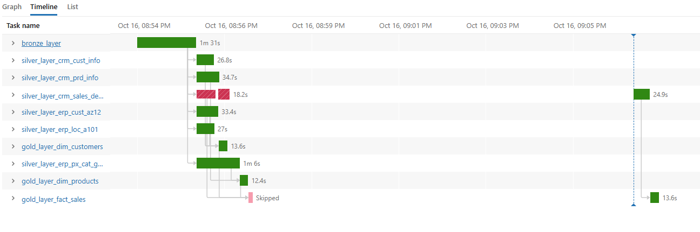
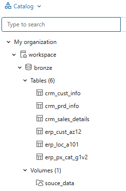
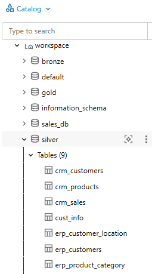
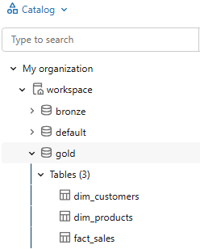

# End-to-End Lakehouse Pipeline on Databricks

An end-to-end cloud data pipeline implemented on **Databricks**, designed to process, clean, and aggregate raw datasets into an analytical data model using PySpark, Delta Lake, Unity Catalog, and Databricks Workflows.

---

## 🏗️ Architecture Overview

The pipeline implements a classic **Medallion Architecture** (Bronze → Silver → Gold) to enforce data quality, schema evolution, and transactional integrity at scale:

1. **Bronze Layer** :
    -- Stores raw data as-is from the source systems. Data is ingested from CSV Files into SQL Server Database.
2. **Silver Layer** :
    -- This layer includes data cleansing, standardization, and normalization processes to prepare data for analysis.
3. **Gold Layer**   :
    --Houses business-ready data modeled into a star schema required for reporting and analytics.

flowchart LR
    A[Raw CSV Files] -->|Volume Ingestion| B[Bronze Delta Layer]
    B -->|PySpark Transformations| C[Silver Delta Layer]
    C -->|Star Schema Aggregations| D[Gold Delta Layer]


<table>
  <tr>
    <th align="center">Data Architecture</th>
  </tr>
  <tr>
    <td align="center"></td>
  </tr>
</table>

---
## 💡 Key Architectural Concepts & Learnings

### Evolution of Big Data Processing
- **Hadoop (MapReduce/HDFS):** Disk-bound (I/O heavy) distributed compute/storage for structured and semi-structured data.
- **Apache Spark:**
  --Memory-first (RAM-based) distributed compute framework, significantly accelerating batch and streaming ETL operations.
- **Data Lake:**
  --Central repository capable of storing structured, semi-structured, and unstructured files, but lacking ACID transaction guarantees and efficient updating mechanisms.
- **Lakehouse (Delta Lake):**
  --Combines the storage cost-efficiency and flexibility of a Data Lake with the ACID transaction reliability, schema enforcement, and versioning (time travel) of a Data Warehouse using open-source Delta/Parquet formats.

---

## 🛠️ Tech Stack & Platform Components

- **Platform:** Databricks
- **Compute Engine:** Apache Spark (PySpark)
- **Storage Format:** Delta Lake (Parquet-backed open format)
- **Data Governance:** Unity Catalog (`Catalog` ──► `Schema` ──► `Tables / Volumes`)
- **Version Control:** Databricks Repos / Git Integration (GitHub)
- **Orchestration:** Databricks Jobs & Pipelines (Scheduled Automated Workflows)

---

## 🚀 Implementation Workflow

### 1. Ingestion & Storage Setup (Bronze Layer)
- Configured Unity Catalog schemas for `bronze`, `silver`, and `gold` layers.
- Created an External Volume under the `bronze` schema to store incoming raw CSV source files.
- Ingested raw CSV datasets into Bronze Delta tables using PySpark DataFrame.

### 2. Standardisation & Cleaning (Silver Layer)
- Built 6 dedicated PySpark transformation notebooks to handle:
  - Data type casting and null checks.
  - Standardisation of string fields and codes.
  - Deduplication and business rule validation.
  - Debugged transformation edge-cases using Databricks Genie / PySpark error handlers.
- Written cleaned data into managed Silver Delta tables.

### 3. Dimensional Modeling (Gold Layer)
- Developed 3 Gold notebooks to build an analytical Star Schema:
  -- **2 Dimension Tables**
  -- **1 Fact Table**

<table>
  <tr>
    <th align="center">Data Architecture</th>
  </tr>
  <tr>
    <td align="center"></td>
  </tr>
</table>

### 4. Orchestration & Automation
- Configured a multi-task **Databricks Job / Workflow** to orchestrate notebook execution dependencies sequentially (`Bronze` ──► `Silver` ──► `Gold`).
- Verified successful automated execution and error-handling triggers.

<table>
  <tr>
    <th align="center">Pipeline Graph</th>
    <th align="center">Pipeline List</th>
    <th align="center">Pipeline Timeline</th>
  </tr>
  <tr>
    <td align="center"></td>
    <td align="center"></td>
    <td align="center"></td>
  </tr>
</table>

### 5. Schema snapshots

<table>
  <tr>
    <th align="center">Catalog Bronze Schema</th>
    <th align="center">Catalog Silver Schema</th>
    <th align="center">Catalog Gold Schema</th>
  </tr>
  <tr>
    <td align="center"></td>
    <td align="center"></td>
    <td align="center"></td>
  </tr>
</table>

---

## 📂 Repository Structure

```text
code
├── bronze_layer/
│   └── bronze_load.py              # Raw CSV to Bronze Delta tables
├── silver_layer/
│   ├── silver_crm_cust_info.py     # Standardisation & transformations
│   ├── silver_crm_prd_info.py      # Standardisation & transformations
│   ├── silver_crm_sales_details.py # Standardisation & transformations
│   ├── silver_erp_cust_az12.py     # Standardisation & transformations
│   └── silver_erp_loc_a101.py      # Standardisation & transformations
│   ├── silver_erp_px_cat_g1v2.py   # Standardisation & transformations
├── 3_gold/
│   ├── gold_dim_customers.py       # Final business ready data for downstream 
│   ├── gold_dim_products.py        # Standardisation & transformations
│   ├── gold_fact_sales.py          # Standardisation & transformations
├── images/                         # Relevant screenshots
└── README.md
```

## 🛡️ License

This project is licensed under the [MIT License](LICENSE.txt). You are free to use, modify, and share this project with proper attribution.